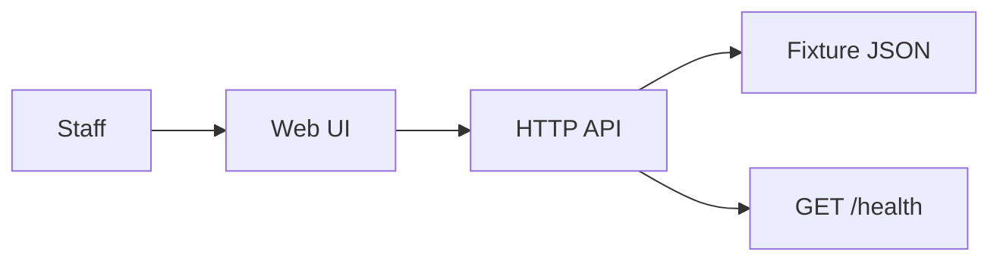
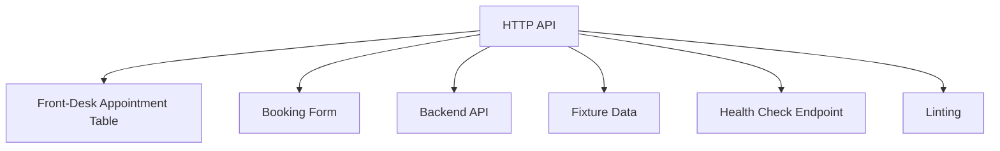
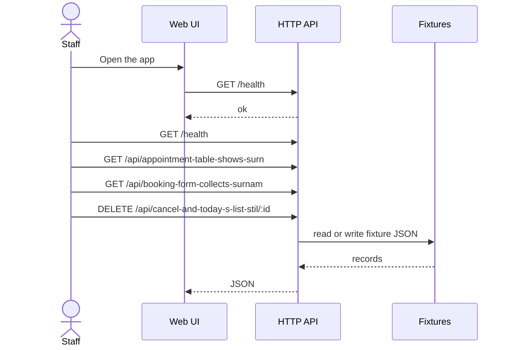

# SCRUM-2 — Add Surname Column

## Intent
Add patient surname on the front-desk list and booking form.

This file is the approved architecture. Code is written from this document. Revise it until you approve.

## System context

## Components

- **Front-Desk Appointment Table** (node) — Display patient details including surname in the appointment list
- **Booking Form** (node) — Collect patient surname along with other booking details
- **Backend API** (python) — Handle surname data in appointment-related API endpoints
- **Fixture Data** (python) — Provide sample data including surnames for testing
- **Health Check Endpoint** (python) — Provide GET /health endpoint for system health monitoring
- **Linting** (node) — Ensure code quality and style compliance
- **Unit Tests** (python) — Test individual components including surname handling
- **Integration Tests** (python) — Test end-to-end functionality including surname addition
- **Fixture store** — JSON under `fixtures/`. No production database.

## APIs

| Method | Path | Purpose |
| --- | --- | --- |
| GET | `/health` | Deploy verify — report ok |
| GET | `/api/appointment-table-shows-surn` | Appointment table shows surname |
| GET | `/api/booking-form-collects-surnam` | Booking form collects surname |
| DELETE | `/api/cancel-and-today-s-list-stil/:id` | Cancel and today’s list still work |

## Request flow

## Technologies
- node
- python

After approval, this is implemented as a Node application. Allow-list: node, python. Packages: https://registry.npmjs.org, https://pypi.org. License: MIT.

## In scope
- Appointment table shows surname
- Booking form collects surname
- Cancel and today’s list still work

## Out of scope
- Production data access
- Work outside this ticket
- A pull request unless auto-open is enabled

## Assumptions
- The existing data model supports adding a surname field or can be extended without major refactoring.
- UI changes will be minimal and limited to adding a surname column and input field.
- No changes are required to cancel and today's list logic beyond ensuring compatibility with surname data.
- The repository uses node for frontend and python for backend components.

## Deploy
After lint, unit, and integration, and after deploy approval, pick Git and a cloud, then run the pipeline. Target **dev**. Rollback owner: **Platform on-call**.

## Planner notes
### Front-Desk List
- Display patient surname alongside existing patient details in the appointment table.

### Booking Form
- Add input field to collect patient surname.
- Validate surname input as required.

### Backend
- Ensure APIs support surname field for appointments.

### Platform Policy Compliance
- Include fixture data for testing surname field.
- Implement GET /health endpoint.
- Apply linting, unit, and integration tests.

